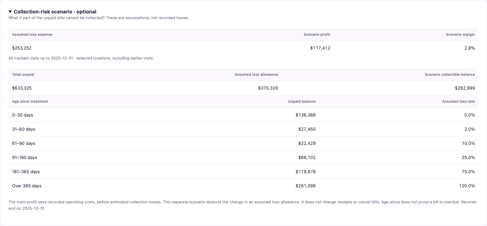

# Financial guide

## The main figures

| Term | Simple meaning |
|---|---|
| Net service revenue | Completed treatment charges after discounts and billing adjustments, before operating costs. |
| Money received | Payments collected during the period, including payments for earlier visits. |
| Operating costs | Costs assigned to the period, including pay, rent, supplies and depreciation. |
| Operating profit | Revenue minus recorded operating costs, **before estimated collection losses**, income tax and financing costs. |
| Operating margin | Profit divided by revenue. An 8.8% margin means $8.80 per $100 revenue on that stated basis. |
| Operating cash surplus | Receipts minus operating expenses actually paid. It is not a bank balance or owner take-home pay. |
| Unpaid at period end | Amount owed for selected visits at the selected end date. Later payments may reduce it. |

A $1,000 treatment, $100 discount and $600 payment produce $900 revenue and $300 unpaid. If operating costs are $700, profit before loss estimates is $200. Collecting the remaining $300 later does not create revenue again. **Do not add unpaid bills to profit.**

## Optional collection-risk scenario

The main dashboard does not treat an invented loss estimate as a recorded cost. The optional scenario asks: **What if some unpaid bills cannot be collected?**

The policy assumes losses of 0%, 2%, 10%, 25%, 75% and 100% for invoice ages of 0–30, 31–60, 61–90, 91–180, 181–365 and over 365 days. These are illustrative stress assumptions, not validated benchmarks. Real use requires observed recovery history.

The allowance is a balance at a date. Its change is the scenario loss expense. We deduct the change once, not the full balance again each year. The scenario changes neither receipts nor legal amounts owed. Age since treatment is not contractual days overdue; payment due dates are unavailable.

For 2025: $370,663.94 main profit − $253,252.43 assumed loss expense = $117,411.51 scenario profit, or 2.8%. **The 8.8% and 2.8% margins answer different questions.** Neither is confirmed final after-tax profit.

## Why unpaid totals differ

The 2025 top card covers **2025 visits only**: $371,430.15 unpaid at December 31, 2025. The risk section includes earlier visits too: **$633,324.86 total unpaid**. Of this, $261,894.71 relates to 2024 visits after payments recorded through 2025.

A 2024 filter shows the historical 2024 year-end balance. There are no 2026 receipt records; these are not current balances.

## Checks

Every branch-month reconciles in cents:

**Main profit + depreciation − increase in unpaid bills + increase in operating payables, net of prepayments = operating cash surplus.**

The scenario bridge adds back its noncash loss expense. Opening unpaid + revenue − receipts = closing unpaid. Weekly and monthly reports reconcile on both bases. Group margin is group profit divided by group revenue, not an average of percentages.

## Annual results

CAD. Main figures and the optional scenario are kept separate.

<!-- ANNUAL_START -->
| Measure | 2024 | 2025 |
|---|---:|---:|
| Service Revenue | $4,389,358.60 | $4,217,135.70 |
| Money Received | $3,995,411.33 | $3,977,758.11 |
| Operating Costs | $3,920,854.40 | $3,846,471.76 |
| Operating Profit | $468,504.20 | $370,663.94 |
| Scenario Loss Expense | $117,073.52 | $253,252.43 |
| Scenario Operating Profit | $351,430.68 | $117,411.51 |
| Cash Operating Payments | $3,563,936.78 | $3,812,594.96 |
| Operating Cash Surplus | $431,474.55 | $165,163.15 |
| Depreciation | $43,200.00 | $43,200.00 |
| Gross Receivables | $393,947.27 | $633,324.86 |
| Scenario Loss Allowance | $117,073.52 | $370,325.95 |
| Scenario Net Receivables | $276,873.75 | $262,998.91 |
| Operating margin | 10.7% | 8.8% |
| Scenario margin | 8.0% | 2.8% |
<!-- ANNUAL_END -->

## Scope

This is a management case study, not complete statutory financial statements. Taxes, borrowing, capital purchases, owner withdrawals and opening bank cash are absent. Owner take-home pay cannot be calculated.

Tracked opening receivables and payables are zero in January 2024. The 2024 cash surplus therefore does not represent a mature clinic's complete cash history. All sites are leased; dentist compensation is modeled at 34% of branch revenue. Fees, staffing and costs are assumptions.

Main report: `weekly_finances`. Optional report: `scenario_weekly_finances`. Run both refresh steps from the README.

References: [BDC: profit and cash](https://www.bdc.ca/en/articles-tools/money-finance/manage-finances/5-tips-manage-cash-flow) · [BDC: accounts receivable](https://www.bdc.ca/en/articles-tools/entrepreneur-toolkit/templates-business-guides/glossary/accounts-receivable).

