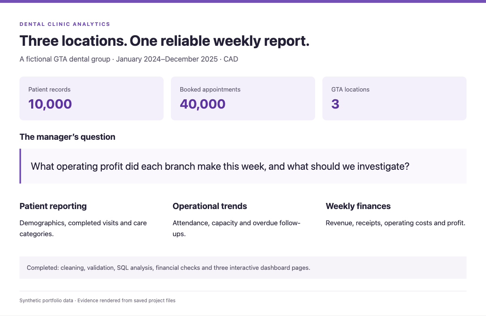
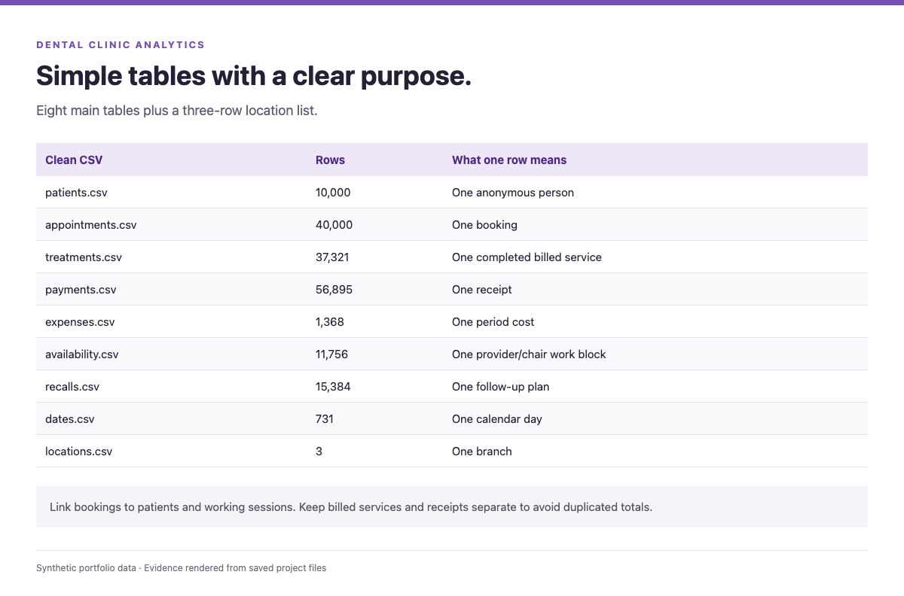
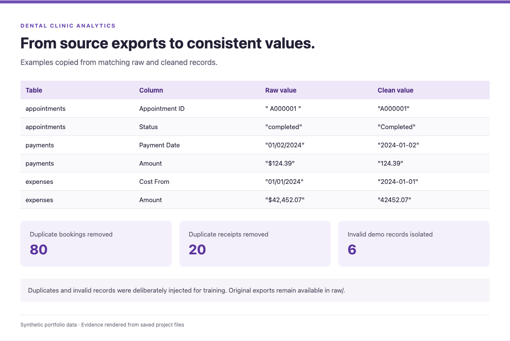
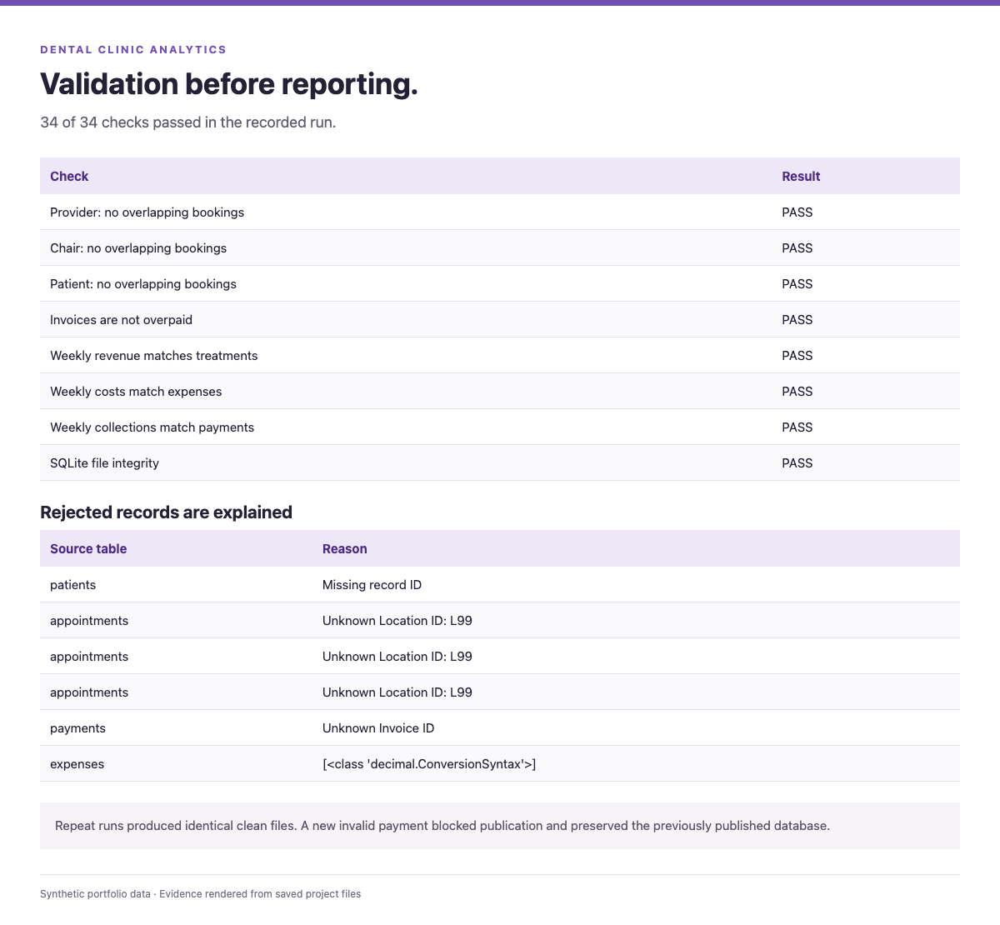
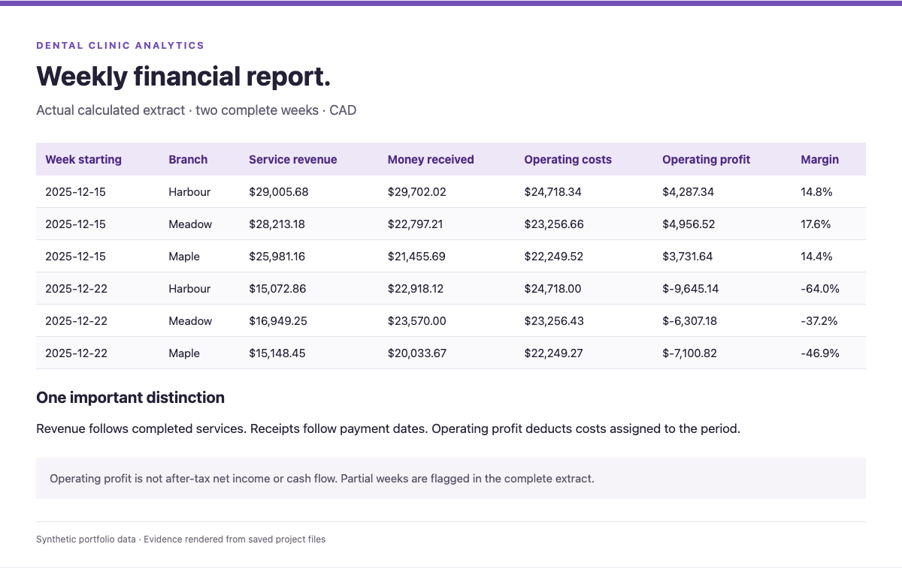
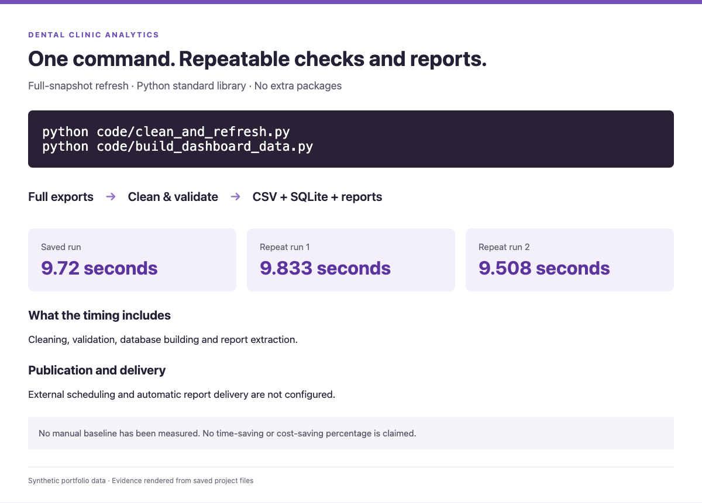

# Process and evidence

The screenshots below show evidence panels populated from saved project files. They explain the workflow; the three dashboard screenshots in the README show the interactive dashboard itself.

## 1. Define the business problem

Patients, appointment capacity and weekly branch finances.

## 2. Give each table a clear purpose

Eight main tables plus a small branch list. Keep treatment charges and receipts separate to prevent duplicated totals.

## 3. Clean the exports

Standardize dates, labels and amounts. Remove identical duplicates and explain invalid records.

## 4. Validate before reporting

All 34 base checks pass. Repeatability and rejection-gate tests are saved with the project. Financial checks separately reconcile all 72 branch-months.

## 5. Produce the weekly report

Revenue follows completed care, costs follow the period they belong to, and receipts follow payment dates. Main profit is before estimated collection losses.

## 6. Make the process repeatable

Run the cleaner, then rebuild financial reports, dashboard data and business answers. Review the checks before publishing.

The measured base runtime is about 9.6 seconds. Staff savings have not been measured. [Timing explanation](SAVINGS_ESTIMATE.md).
