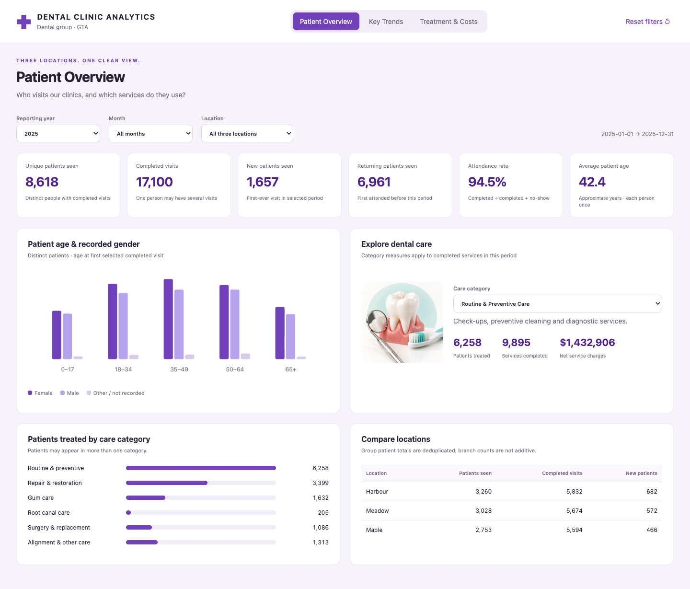

# Dental Clinic Analytics

Built on a simulated dataset modelled on a 3-branch dental group (10,000 patients, 2024-2025).

**[Open the interactive dashboard](https://ekhodada.github.io/dental-clinic-analytics/)**

I bring patient activity, appointment performance and clinic finances into one clear report.

| Business question | What I found in 2025 | Recommended action |
|---|---|---|
| Which services do patients use most? | Routine care accounts for 53.6% of completed services. | Protect check-up and hygiene availability. |
| Where are appointments being lost? | Maple has the highest no-show rate; Meadow has the highest cancellation rate. | Test reminders and a short-notice waitlist. |
| Why did profit fall? | Revenue fell CAD $172K; costs fell only CAD $74K. | Review unfilled appointments and branch costs. |

## Three dashboard pages

- **Patient Overview:** who attends and which care they receive.
- **Key Trends:** completed visits, cancellations, no-shows and follow-ups.
- **Treatment & Costs:** revenue, receipts, costs, profit and weekly reporting.

I use year, month and branch filters to investigate changes and download the weekly report.

[Key Trends preview](docs/images/08-key-trends.png) · [Treatment & Costs preview](docs/images/09-treatment-costs.png)

I clean the data, run **34 quality checks**, and reconcile profit to cash across **72 branch-months**.

[Business questions and answers](BUSINESS_QUESTIONS.md)
