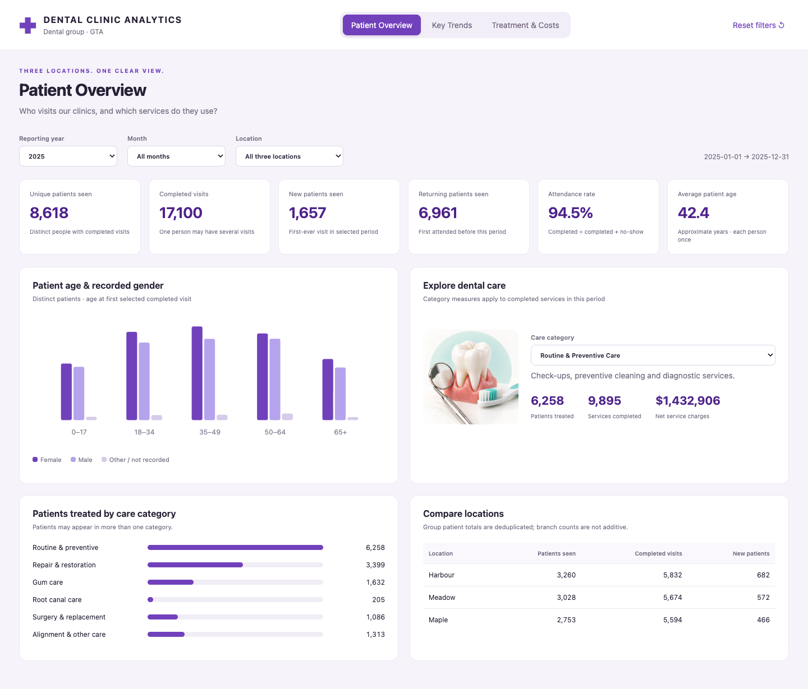
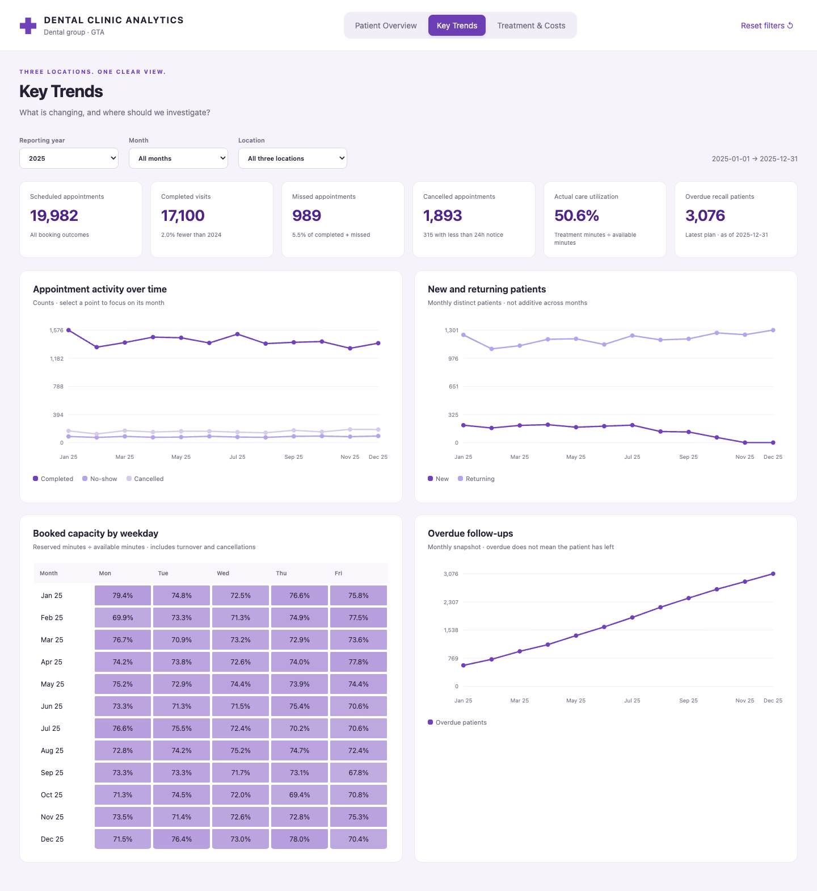
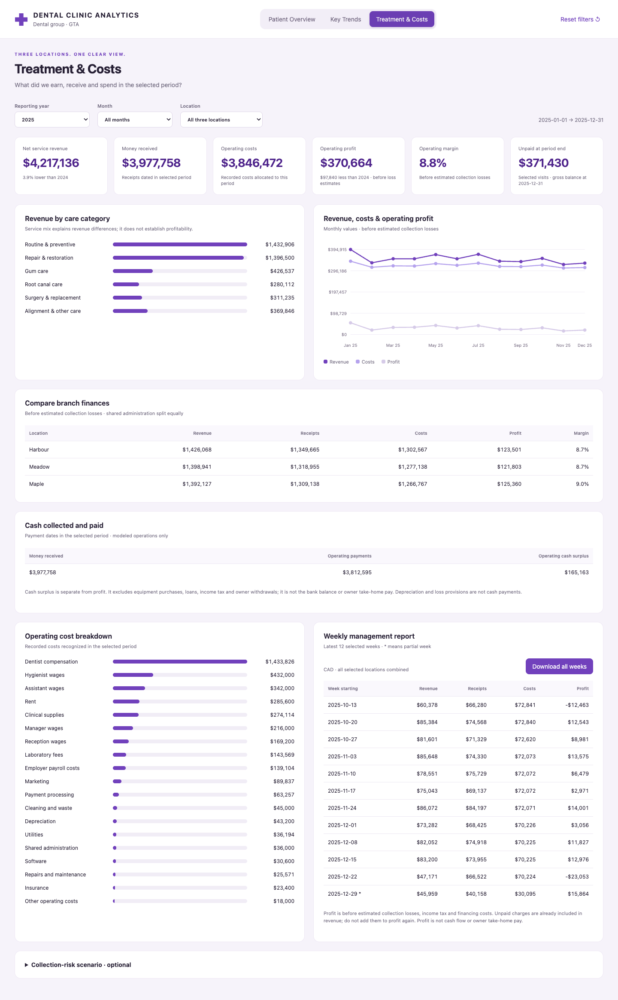

# Dental Clinic Analytics

**Patient activity, appointment performance and weekly finances across three GTA branches.**  
By [Elnaz Khodadadi](https://github.com/ekhodada)

**[Open the interactive dashboard](https://ekhodada.github.io/dental-clinic-analytics/)** · [Business questions and answers](BUSINESS_QUESTIONS.md) · [Metric guide](DASHBOARD_GUIDE.md)

## The business problem

A dental group needs one clear view of its patients, appointment capacity and finances. This project turns separate exports into checked data, repeatable reports and three interactive dashboard pages.

The case study uses **synthetic data**, not real patient records: three GTA locations, 10,000 patient records and 40,000 appointments across **2024 and 2025**. All amounts are Canadian dollars.

## Three questions, three answers

| Business question | Finding in 2025 | Recommended action |
|---|---|---|
| Which services do patients use most? | Routine and preventive care represents 53.6% of completed services. | Protect check-up and hygiene availability; review waiting times before changing capacity. |
| Where should we investigate appointment performance? | Maple has the highest missed-visit rate; Meadow has the highest cancellation rate. | Review reasons and booking lead times; pilot reminders and a short-notice waitlist. |
| Why did profit fall? | Revenue fell $172,223; costs fell only $74,383. Profit fell $97,840. | Review weekly branch costs, unfilled slots and older unpaid bills together. |

[Read the evidence and follow-up measures](BUSINESS_QUESTIONS.md). Recommendations are proposed actions; no revenue, retention or cost improvement is claimed.

## The dashboards

### Patient Overview

Who visits, where they attend and which services they use. Group patient totals count each person once.



### Key Trends

Completed, missed and cancelled appointments; clinical capacity; new and returning patients; overdue follow-ups.



### Treatment & Costs

Revenue, collections, costs, branch profit and weekly reports. Cash and an optional collection-risk scenario are separate.



Year, month and branch filters work across the pages. Chart points select a month. The financial page downloads the selected weekly report.

## Financial results

| Measure | 2024 | 2025 |
|---|---:|---:|
| Service revenue | $4,389,359 | $4,217,136 |
| Operating costs | $3,920,854 | $3,846,472 |
| Operating profit | $468,504 | $370,664 |
| Operating margin | 10.7% | 8.8% |
| Operating cash surplus | $431,475 | $165,163 |

**Profit and margin above are before estimated collection losses, income tax and financing costs.** They are not owner take-home pay. Revenue includes unpaid charges; collections use payment dates. The optional loss scenario uses stated assumptions and is not mixed into recorded costs. [Financial guide](FINANCIAL_MODEL.md).

## From exports to decisions

1. Import complete source exports with stable IDs.
2. Clean formats and remove identical duplicates.
3. Check relationships, visit times, capacity and money totals.
4. Build clean tables, SQL reports and financial reconciliations.
5. Refresh the dashboards and business answers.
6. Recommend an action and define how to measure it.

The test data contains **100 injected duplicates and six known invalid records**. All **34 base checks** pass. Financial checks reconcile profit to cash for **72 branch-months**. Weekly and monthly reports match on both the main and scenario basis.

[Process screenshots](PROCESS.md) · [Quality checks](processed/quality_checks.csv) · [Financial checks](processed/financial_checks.json)

## Run locally

Requires Python 3.10+; no extra Python packages.

```bash
python3 code/clean_and_refresh.py
python3 code/build_dashboard_data.py
```

Or use `refresh_mac.command` / `refresh_weekly.bat`. Then open `index.html`. Local refreshes are published only after committing and pushing the updated files.

## Files and guides

| Location | Contents |
|---|---|
| `raw/` | Synthetic source exports |
| `processed/clean/` | Clean data and the generated calendar |
| `processed/reports/` | Weekly, monthly, annual and invoice-aging reports |
| `code/` | Python cleaning, financial checks and SQL analysis |
| `dashboard/` | Interactive dashboard and data snapshot |
| `docs/images/` | Dashboard and process screenshots |
| [column_guide.csv](column_guide.csv) | Meaning of each data field |
| [DATA_NOTES.md](DATA_NOTES.md) | Data structure and assumptions |
| [DASHBOARD_GUIDE.md](DASHBOARD_GUIDE.md) | Plain-English definitions |
| [SAVINGS_ESTIMATE.md](SAVINGS_ESTIMATE.md) | Runtime evidence and how to measure savings |

**Skills demonstrated:** requirements gathering, Python cleaning, SQL analysis, data validation, financial reconciliation, dashboard design and clear recommendations.
